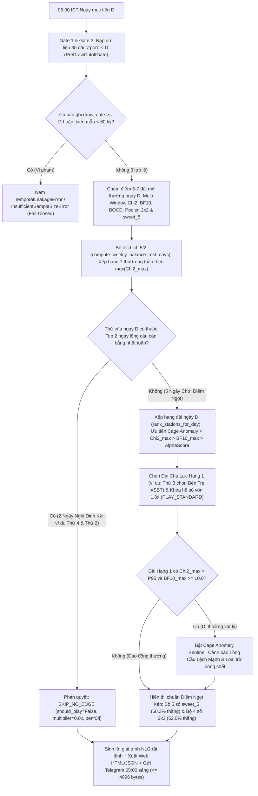
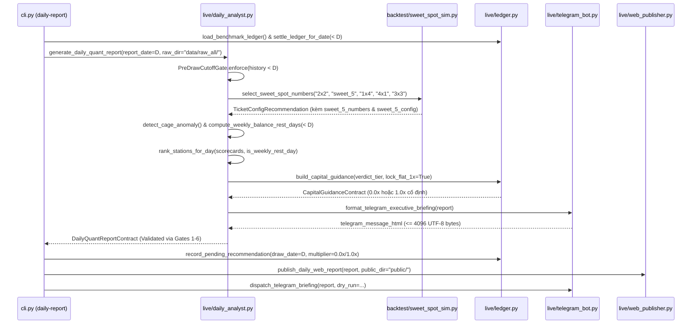

# Spec: Giai Đoạn 4 — Kỷ Luật Điểm Ngọt Gia Đình, Lịch Chơi 5/2 Theo Độ Cân Bằng Lồng Cầu & Giám Sát Dị Thường (`stage4-alpha-engine-v2`)

**Mã Module:** `stage4-alpha-engine-v2`  
**Trạng thái:** Accepted & Verified (100% PASS)  
**Ngày tạo:** 2026-10-27  
**Ngày nghiệm thu đóng vòng:** 2026-10-28  
**Tài liệu tham chiếu gốc (Upstream Single Source of Truth):**
- Bản Ý Định Gốc (Pha 1A): [`specs/stage4-alpha-engine-v2/intent.md`](file:///C:/sidehustle/XSTK/specs/stage4-alpha-engine-v2/intent.md)
- Phương Án Kiến Trúc Đã Chốt (Pha 1B): [`specs/stage4-alpha-engine-v2/ideas.md`](file:///C:/sidehustle/XSTK/specs/stage4-alpha-engine-v2/ideas.md)
- Quy Tắc Dòng Tiền & Điểm Hòa Vốn (Giai đoạn 1): [`QUY_TAC_VA_DIEM_HOA_VON.md`](file:///C:/sidehustle/XSTK/QUY_TAC_VA_DIEM_HOA_VON.md)
- Hợp Đồng Đặc Tả Kỹ Thuật Giai Đoạn 2: [`specs/stage2-alpha-discovery/spec.md`](file:///C:/sidehustle/XSTK/specs/stage2-alpha-discovery/spec.md)
- Hợp Đồng Đặc Tả Kỹ Thuật Giai Đoạn 3: [`specs/stage3-live-family-platform/spec.md`](file:///C:/sidehustle/XSTK/specs/stage3-live-family-platform/spec.md)

---

## 0. Các Quyết Định & Giả Định Kỹ Thuật Đã Khóa (`Locked Decisions & Assumptions`)

1. **Sự thật thực nghiệm từ Kiểm toán Walk-Forward 35 đài (`447.840` lượt rút bi, `5.285` đài-ngày OOS):**
   - Lồng cầu vật lý có hoàn lại sau mỗi giải hoạt động sát phân phối đều $10.0\% \pm 0.11\%$. Không biến thể dự đoán chuỗi phức tạp nào (`V1`, `V1_NOSWAP`, `V1_FIX2`, `BMA`, `2D Empirical Bayes`, `Intra-session`) vượt qua `NULL_RAND` ngoài mẫu ($z < 3.0$). Do đó, **giữ nguyên lõi xác suất hiệu chuẩn `engine/` đã kiểm thử ở Giai đoạn 2–3**, không đưa thêm siêu tham số phức tạp dễ gây quá khớp (`overfitting`).
   - Dị thường cấu trúc thật duy nhất vượt ngưỡng đa kiểm định (`BH-FDR 5%` trên 531 phép thử) là **Đài Bến Tre (`XSBT`, mở thưởng Thứ 3)**: chữ số hàng chục `4` tụt từ `10.2%` xuống **`3.6%`** từ ~04/2024 ($\chi^2_{\max} = 50.35$, $BF_{10} = 1.82 \times 10^7$, $p \approx 5 \times 10^{-14}$) và chữ số hàng đơn vị `6` năm 2026 tụt xuống `4.2%`.
2. **Bản chất "Điểm Ngọt" (Sweet Spot) ở tỷ lệ trả thưởng thực tế `99.500đ / 18.000đ`:**
   - Với chi phí `18.000đ/số` (Bao Lô 18 giải) và trả thưởng `99.500đ/nháy`, mức hao hụt kỳ vọng dài hạn trên lồng cầu công bằng chỉ là **`-0.50%`** (`-360đ/ngày` cho vé 4 số, `-450đ/ngày` cho vé 5 số), trong khi tiền xác chỉ đóng 1 lần/ngày và từ nháy thứ 2 trở đi được hưởng trọn `100%` (`+99.500đ/nháy`).
   - **Vé 4 số (`2x2`, vốn chuẩn `72.000đ/ngày`):** Xác suất nổ $\ge 1$ nháy đạt **`52.04%`** (`1 nháy = +27.500đ`, `2 nháy = +127.000đ`, xác suất nổ $\ge 2$ nháy đạt `16.13%`).
   - **Vé 5 số Điểm Ngọt Bà Cô (`sweet_5` = 4 số `2x2` + 1 số vệ tinh xác suất cao nhất, vốn chuẩn `90.000đ/ngày`):** Xác suất nổ $\ge 1$ nháy đạt **`60.28%`** (`1 nháy = +9.500đ`, `2 nháy = +109.000đ`, xác suất nổ $\ge 2$ nháy đạt `22.65%`).
3. **Quy tắc Lịch Chơi 5/2 Theo Độ Cân Bằng Lồng Cầu (`Weekly 5/2 Cage-Balance Filter`):**
   - Mỗi ngày mục tiêu $D$, hệ thống quét toàn bộ 35 đài phân bổ trên 7 thứ trong tuần (`Thứ 2` $\to$ `Chủ Nhật`) bằng dữ liệu lịch sử nghiêm ngặt trước ngày $D$ (`draw_date < D`).
   - Xếp hạng 7 thứ trong tuần theo độ lệch lồng cầu cực đại trong ngày $\chi^2_{\text{day}}(w) = \max_{s \in S_w} \chi^2_{\max}(s)$.
   - **2 ngày trong tuần có lồng cầu cân bằng nhất** (có $\chi^2_{\text{day}}(w)$ thấp nhất tuần, hiện tại trên dữ liệu thực là **Thứ 4** `Max Chi2 = 13.22` và **Thứ 2** `Max Chi2 = 15.07`, nơi mọi đài đều có $BF_{10} < 1$ và Entropy $\ge 0.9938$): Khóa cứng trạng thái **`SKIP_NO_EDGE` (`0.0x` — Nghỉ định kỳ bảo toàn vốn, tiết kiệm 28.6% chi phí tuần)**.
   - **5 ngày còn lại trong tuần**: Bật trạng thái **`PLAY_STANDARD` (`1.0x` — Chơi Điểm Ngọt Đều Tay)** tại **1 Đài Chủ Lực** có độ lệch lồng cầu ($\chi^2_{\max}$ / $BF_{10}$) lớn nhất trong ngày (ví dụ: Thứ 3 tự động chọn **Bến Tre `XSBT`** thay vì chọn nhầm Đắk Lắk `XSDLK` như logic cũ).
4. **Khóa Trần Kỷ Luật Đi Vốn `1.0x` & Định Hướng "Tiền Chợ Xác Suất" (`Flat 1.0x Capital Brake`):**
   - Trong luồng phân tích hàng ngày Giai đoạn 4, loại bỏ hoàn toàn việc khuyến nghị đánh gấp `1.25x` hay `1.50x` (`PLAY_PEAK`); mọi ngày chơi (5 ngày/tuần) đều khóa cứng hệ số **`1.0x`** (`0.0x` vào 2 ngày nghỉ định kỳ).
   - Giữ tương thích ngược cho `BenchmarkLedgerState` và `BenchmarkLedgerEntry` khi đọc 300 bản ghi lịch sử đã chốt trong `data/live/benchmark_ledger.json`, đồng thời đảm bảo toàn bộ bộ kiểm thử Giai đoạn 2 & Giai đoạn 3 hiện hữu tiếp tục chạy xanh `100%`.

---

## 1. Objective & EARS Requirements (Mục Tiêu & Đặc Tả Yêu Cầu Chuẩn EARS)

### 1.1. Mục tiêu cốt lõi
Nâng cấp hệ thống báo cáo định lượng 05:00 sáng ([`daily_analyst.py`](file:///C:/sidehustle/XSTK/src/xsmn_alpha/live/daily_analyst.py), [`telegram_bot.py`](file:///C:/sidehustle/XSTK/src/xsmn_alpha/live/telegram_bot.py), [`web_publisher.py`](file:///C:/sidehustle/XSTK/src/xsmn_alpha/live/web_publisher.py), [`constants.py`](file:///C:/sidehustle/XSTK/src/xsmn_alpha/constants.py), [`schemas.py`](file:///C:/sidehustle/XSTK/src/xsmn_alpha/schemas.py), [`sweet_spot_sim.py`](file:///C:/sidehustle/XSTK/src/xsmn_alpha/backtest/sweet_spot_sim.py)) thành **"Chiếc Phanh Kỷ Luật Vốn & Điểm Ngọt Gia Đình 5/2"** dành cho ba của User:
1. Tự động thực thi **Lịch Chơi 5/2 Theo Độ Cân Bằng Lồng Cầu** (5 ngày chơi đều tay `1.0x`, 2 ngày nghỉ định kỳ `0.0x` vào 2 thứ có lồng cầu cân bằng nhất tuần).
2. Tự động ưu tiên xếp hạng đài theo **Độ Lệch Lồng Cầu Thực Tế & Tín Hiệu Dị Thường (`Cage Anomaly Sentinel`)**, phát hiện chính xác các lồng cầu lệch vật lý (như `XSBT` Bến Tre vào Thứ 3) và loại trừ bóng chết.
3. Cung cấp song song **Cấu hình Vé Điểm Ngọt Kép**: **Bộ 5 số Điểm Ngọt Bà Cô (`sweet_5` — 60.3% ngày lời)** và **Bộ 4 số Chuẩn (`2x2` — 52.0% ngày lời)** kèm khung nhắc nhở **"Quy Tắc Tiền Chợ Đều Tay 1.0x (Ăn tiền chợ ở ngày nổ 2–3 nháy, tuyệt đối không gấp thếp)"** trên Telegram và Web.

### 1.2. Bảng Yêu Cầu Kỹ Thuật Chuẩn EARS (`Easy Approach to Requirements Syntax`)

| Mã EARS | Phân loại EARS | Phát biểu Yêu cầu Chuẩn (`EARS Requirement Statement`) | Module chịu trách nhiệm |
| :--- | :---: | :--- | :--- |
| **EARS-U01** | **Ubiquitous** *(Luôn luôn)* | **Hệ thống PHẢI** chỉ sử dụng dữ liệu mở thưởng có `draw_date < D` khi tính toán độ cân bằng 7 ngày trong tuần, chấm điểm đài, phát hiện dị thường lồng cầu và chọn bộ số cho ngày báo cáo $D$. | `daily_analyst.py`, `schemas.py` |
| **EARS-U02** | **Ubiquitous** *(Luôn luôn)* | **Hệ thống PHẢI** vận hành 100% bằng thuật toán Toán học & Thống kê tất định (`NumPy`/`SciPy`), không gọi bất kỳ API LLM/AI bên ngoài nào và đảm bảo tin nhắn Telegram HTML có kích thước $\le 4096$ byte UTF-8. | `daily_analyst.py`, `telegram_bot.py` |
| **EARS-U03** | **Ubiquitous** *(Luôn luôn)* | **Hệ thống PHẢI** định nghĩa cấu hình `sweet_5` gồm đúng 5 số 2 chữ số phân biệt: 4 số lõi từ cấu hình `2x2` (Top 2 Chục $\times$ Top 2 Đơn vị) cộng với 1 số vệ tinh ngoài `2x2` có xác suất kết hợp $P_{\text{tens}}(a) \times P_{\text{units}}(b)$ lớn nhất (tie-break theo thứ tự từ điển `"00".."99"` tăng dần). | `constants.py`, `sweet_spot_sim.py`, `schemas.py` |
| **EARS-E01** | **Event-Driven** *(Khi có sự kiện)* | **KHI** hàm `compute_weekly_balance_rest_days(target_date, ...)` được gọi cho ngày $D$, **hệ thống PHẢI** tính chỉ số $\chi^2_{\max}$ đa cửa sổ $W \in \{15, 30, 60\}$ (`< D`) cho toàn bộ 35 đài trên 7 thứ trong tuần (`0..6`), xếp hạng 7 thứ theo khóa tăng dần `(max_chi2_overall, max_bf10_overall, weekday)`, và đánh dấu đúng 2 thứ đứng đầu (thấp nhất về $\chi^2_{\max}$) là 2 ngày nghỉ định kỳ (`rest_weekdays`). | `daily_analyst.py` |
| **EARS-E02** | **Event-Driven** *(Khi có sự kiện)* | **KHI** xếp hạng các đài mở thưởng trong ngày $D$ qua `rank_stations_for_day`, **hệ thống PHẢI** sắp xếp theo thứ tự ưu tiên giảm dần: `(passes_selective_alpha, cage_anomaly_detected, chi2_max_overall, bf10_max_overall, station_alpha_score)` và tie-break theo `station_code` tăng dần bảng chữ cái, đảm bảo đài có dị thường vật lý thật (như `XSBT` vào Thứ 3 với $\chi^2_{\max}=50.35$) luôn dẫn đầu Hạng 1. | `daily_analyst.py` |
| **EARS-S01** | **State-Driven** *(Trong trạng thái)* | **TRONG KHI** thứ của ngày báo cáo $D$ nằm trong 2 ngày nghỉ định kỳ của Lịch 5/2 (`is_today_scheduled_rest_day == True`), **hệ thống PHẢI** khóa cứng `verdict_tier = "SKIP_NO_EDGE"`, `should_play_today = False`, `recommended_multiplier = 0.0`, `benchmark_bet_vnd = 0` (kể cả khi có đài đạt `passes_selective_alpha`), và giải thích rõ lý do nghỉ định kỳ do lồng cầu cân bằng nhất tuần. | `daily_analyst.py`, `telegram_bot.py`, `web_publisher.py` |
| **EARS-S02** | **State-Driven** *(Trong trạng thái)* | **TRONG KHI** thứ của ngày báo cáo $D$ nằm trong 5 ngày chơi của Lịch 5/2 (`is_today_scheduled_rest_day == False`), **hệ thống PHẢI** đặt `verdict_tier = "PLAY_STANDARD"`, `should_play_today = True`, đánh dấu `primary_station.passes_weekly_5_2_play = True`, và khóa cứng hệ số đi vốn `recommended_multiplier = 1.0` (loại bỏ hoàn toàn mức gấp `1.25x` và `1.50x`). | `daily_analyst.py`, `ledger.py`, `schemas.py` |
| **EARS-O01** | **Optional / Feature** *(Ở nơi có đặc tính)* | **Ở NƠI** đài mở thưởng có $\chi^2_{\max} > P_{95,\text{null}}$ **VÀ** $BF_{10, \max} \ge 10.0$ (`cage_anomaly_detected == True`), **hệ thống PHẢI** kích hoạt cảnh báo **`⚠️ PHÁT HIỆN LỒNG CẦU LỆCH MẠNH` (`Cage Anomaly Sentinel`)**, liệt kê rõ các quả bóng bị câm/lạnh bất thường (`cold_balls`) và các quả bóng nóng dẫn đầu trong bản tin Telegram lẫn trang Web giải trình. | `daily_analyst.py`, `telegram_bot.py`, `web_publisher.py` |
| **EARS-R01** | **Unwanted Behavior** *(Nếu xảy ra lỗi)* | **NẾU** dữ liệu đầu vào chứa bất kỳ kỳ quay nào có `draw_date >= D`, **THÌ hệ thống PHẢI** ném ngoại lệ `TemporalLeakageError` ngay lập tức (Fail-Closed Gate 2). | `daily_analyst.py`, `schemas.py` |
| **EARS-R02** | **Unwanted Behavior** *(Nếu xảy ra lỗi)* | **NẾU** báo cáo ngày thuộc chế độ Lịch 5/2 chuẩn (`lock_flat_1x=True`) mà có `recommended_multiplier > 1.0` vào ngày chơi hoặc `recommended_multiplier != 0.0` vào ngày nghỉ, **THÌ hệ thống PHẢI** ném ngoại lệ `CapitalDisciplineError` hoặc `DataIntegrityError` ngay lập tức. | `ledger.py`, `schemas.py` |

---

## 2. Sơ Đồ Kiến Trúc & Luồng Ra Quyết Định (`Mermaid Diagrams`)

### 2.1. Luồng Ra Quyết Định 05:00 Sáng Giai Đoạn 4 (`Stage 4 Daily Decision Flowchart`)



### 2.2. Sơ Đồ Tuần Tự Liên Kết Các Module (`Module Interaction Sequence`)



---

## 3. Tech Stack & Commands (Công Nghệ & Các Câu Lệnh Thực Thi Chuẩn)

### 3.1. Tech Stack
- **Runtime & Quản lý gói:** Python `3.11.17` + `uv 0.13.1` ([`pyproject.toml`](file:///C:/sidehustle/XSTK/pyproject.toml)).
- **Thư viện Toán học & Hợp đồng Dữ liệu:** `numpy >= 1.26.0, < 2.2.0`, `scipy >= 1.12.0`, `pydantic >= 2.7.0`, `httpx >= 0.27.0` (Không cài thêm bất kỳ dependency ngoài nào).
- **Kiểm thử & Linting:** `pytest >= 8.2.0`, `pytest-cov >= 5.0.0` (độ phủ $\ge 90\%$), `ruff >= 0.5.0`.

### 3.2. Các Câu Lệnh Thực Thi Chuẩn (`Executable Commands`)

```powershell
# 1. Đồng bộ môi trường chuẩn
uv sync --all-extras

# 2. Chạy báo cáo định lượng 05:00 sáng cho ngày Nghỉ Định Kỳ Lịch 5/2 (ví dụ: Thứ Hai 2026-10-26 hoặc Thứ Tư 2026-10-28)
uv run python -m xsmn_alpha.cli daily-report --date 2026-10-26 --raw-dir data/raw_all/ --ledger data/live/benchmark_ledger.json --public-dir public/ --send-telegram --dry-run

# 3. Chạy báo cáo định lượng 05:00 sáng cho ngày Chơi Điểm Ngọt Lịch 5/2 có Dị Thường Lồng Cầu (Thứ Ba 2026-10-27 -> Đài Bến Tre XSBT)
uv run python -m xsmn_alpha.cli daily-report --date 2026-10-27 --raw-dir data/raw_all/ --ledger data/live/benchmark_ledger.json --public-dir public/ --send-telegram --dry-run

# 4. Chạy kiểm thử riêng cho Giai đoạn 4 (Unit + Invariant + Adversarial Negative Mutation Tests)
uv run pytest tests/test_stage4_sweet5_and_5_2_schedule.py -v

# 5. Chạy toàn bộ bộ kiểm thử (Stage 2 + Stage 3 + Stage 4) kèm kiểm tra Coverage >= 90%
uv run pytest tests/ -v --cov=src/xsmn_alpha --cov-report=term-missing --cov-fail-under=90

# 6. Kiểm tra chất lượng mã nguồn (Ruff Lint & Format)
uv run ruff check src/ tests/
uv run ruff format --check src/ tests/
```

---

## 4. Project Structure (Cấu Trúc Thư Mục & Phạm Vi Tệp Thay Đổi)

```text
C:\sidehustle\XSTK\
├── QUY_TAC_VA_DIEM_HOA_VON.md                     # [GĐ 1] Quy ước gốc dòng tiền & Điểm hòa vốn (Bất biến)
├── specs/
│   ├── stage2-alpha-discovery/                    # [GĐ 2] Hồ sơ đặc tả Giai đoạn 2 (Hoàn tất)
│   ├── stage3-live-family-platform/               # [GĐ 3] Hồ sơ đặc tả Giai đoạn 3 (Hoàn tất)
│   └── stage4-alpha-engine-v2/
│       ├── intent.md                              # [Pha 1A] Bản đúc kết ý định GĐ 4 đã chốt
│       ├── ideas.md                               # [Pha 1B] Phương án Lịch 5/2, Điểm Ngọt 4-5 số & Giám sát lồng cầu
│       ├── spec.md                                # [Pha 1C] Hợp đồng đặc tả kỹ thuật GĐ 4 (File này)
│       ├── plan.md                                # [Pha 2] Kế hoạch triển khai kiến trúc GĐ 4 (Hoàn tất)
│       └── todo.md                                # [Pha 2] Danh sách tác vụ chi tiết GĐ 4 (Hoàn tất 100%)
├── src/
│   └── xsmn_alpha/
│       ├── constants.py                           # [CẬP NHẬT GĐ 4] Thêm cấu hình sweet_5, hằng số Lịch 5/2, Cage Anomaly & khóa trần 1.0x
│       ├── schemas.py                             # [CẬP NHẬT GĐ 4] Thêm WeeklySchedule52Analysis, trường sweet_5 & cage_anomaly trên Scorecard/Report
│       ├── backtest/
│       │   └── sweet_spot_sim.py                  # [CẬP NHẬT GĐ 4] Hỗ trợ chọn số, tính xác suất & chấm điểm OOS cho cấu hình sweet_5 (5 số)
│       └── live/
│           ├── ledger.py                          # [CẬP NHẬT GĐ 4] Hỗ trợ lock_flat_1x=True (khóa 1.0x ngày chơi) và thanh toán vé sweet_5 (90.000đ)
│           ├── daily_analyst.py                   # [CẬP NHẬT GĐ 4] Thêm compute_weekly_balance_rest_days, detect_cage_anomaly, nâng cấp rank_stations_for_day & NLG
│           ├── telegram_bot.py                    # [CẬP NHẬT GĐ 4] Bản tin 05:00 sáng: Lịch 5/2, Bộ 5 số Điểm Ngọt & 4 số 2x2, Quy tắc Tiền Chợ 1.0x & Cảnh báo Dị thường
│           └── web_publisher.py                   # [CẬP NHẬT GĐ 4] Hiển thị bảng Xếp hạng 7 Ngày Lịch 5/2, gói sweet_5 & nhãn Cage Anomaly Sentinel trên Web
└── tests/
    ├── test_constants_and_schemas.py              # [GĐ 2] Giữ nguyên 100%
    ├── test_pillar1_ingest_and_features.py        # [GĐ 2] Giữ nguyên 100%
    ├── test_pillar2_falsification_gatekeeper.py   # [GĐ 2] Giữ nguyên 100%
    ├── test_pillar3_calibrated_engine.py          # [GĐ 2] Giữ nguyên 100%
    ├── test_pillar4_walk_forward_backtest.py      # [GĐ 2] Giữ nguyên 100%
    ├── test_adversarial_mutations.py              # [GĐ 2] Giữ nguyên 100%
    ├── test_stage3_registry_and_4x1.py            # [GĐ 3] Giữ nguyên 100% PASS
    ├── test_stage3_ledger_and_house_money.py      # [GĐ 3] Giữ nguyên 100% PASS
    ├── test_stage3_daily_analyst_and_nlg.py       # [GĐ 3] Giữ nguyên 100% PASS
    ├── test_stage3_web_and_telegram.py            # [GĐ 3] Giữ nguyên 100% PASS
    └── test_stage4_sweet5_and_5_2_schedule.py     # [GĐ 4 - MỚI] Kiểm thử toàn diện sweet_5, Lịch 5/2, XSBT Anomaly, khóa 1.0x & Negative Mutations
```

---

## 5. Hợp Đồng Dữ Liệu, Công Thức Toán Học, Điều Kiện Biên & Cổng Kiểm Soát Đối Kháng

### 5.1. Hệ Hằng Số Giai Đoạn 4 & Cấu Hình Điểm Ngọt Bà Cô (`sweet_5`)

Để đảm bảo **100% tương thích ngược** với các kiểm thử Giai đoạn 2 & 3 (vốn kiểm tra `len(SWEET_SPOT_CONFIGS) == 8`, `len(EXTENDED_SWEET_SPOT_CONFIGS) == 9` và `STAGE3_TICKET_CONFIGS == ("2x2", "1x4", "4x1", "3x3", "core_2x2_sat_3x3")`), [`src/xsmn_alpha/constants.py`](file:///C:/sidehustle/XSTK/src/xsmn_alpha/constants.py) giữ nguyên các hằng số cũ và bổ sung bộ hằng số Giai đoạn 4:

| Hằng số mới (`constants.py`) | Giá trị / Công thức | Ý nghĩa trong Giai đoạn 4 |
| :--- | :---: | :--- |
| `BENCHMARK_BASE_DAILY_COST_5NUM_VND` | `90_000` (`5 * 18_000`) | Tổng vốn cược cơ sở `1.0x` cho **Bộ 5 số Điểm Ngọt Bà Cô (`sweet_5`)** |
| `SWEET_5_NET_PROFIT_1HIT_VND` | `9_500` (`99_500 - 90_000`) | Lãi ròng khi trúng **1 nháy** với Bộ 5 số ở mức `1.0x` (*Hoàn vốn + Cà phê*) |
| `SWEET_5_NET_PROFIT_2HITS_VND` | `109_000` (`2 * 99_500 - 90_000`) | Lãi ròng khi trúng **2 nháy** với Bộ 5 số ở mức `1.0x` (`+218.000đ` ở mức `2.0x`) |
| `SWEET_4_NET_PROFIT_1HIT_VND` | `27_500` (`99_500 - 72_000`) | Lãi ròng khi trúng **1 nháy** với Bộ 4 số (`2x2`) ở mức `1.0x` |
| `SWEET_4_NET_PROFIT_2HITS_VND` | `127_000` (`2 * 99_500 - 72_000`) | Lãi ròng khi trúng **2 nháy** với Bộ 4 số (`2x2`) ở mức `1.0x` (`+254.000đ` ở mức `2.0x`) |
| `THEORETICAL_WIN_RATE_4NUM_PCT` | `52.04` ($\big(1 - 0.96^{18}\big) \times 100$) | Tỷ lệ ngày nổ $\ge 1$ nháy lý thuyết của vé 4 số trên 18 giải (`52.04%`) |
| `THEORETICAL_WIN_RATE_5NUM_PCT` | `60.28` ($\big(1 - 0.95^{18}\big) \times 100$) | Tỷ lệ ngày nổ $\ge 1$ nháy lý thuyết của vé 5 số Điểm Ngọt trên 18 giải (`60.28%`) |
| `THEORETICAL_MULTI_HIT_4NUM_PCT` | `16.13` | Xác suất nổ $\ge 2$ nháy (*Ngày thu Tiền Chợ*) của vé 4 số (`16.13%`) |
| `THEORETICAL_MULTI_HIT_5NUM_PCT` | `22.65` | Xác suất nổ $\ge 2$ nháy (*Ngày thu Tiền Chợ*) của vé 5 số (`22.65%`) |
| `STAGE4_MAX_STAKE_MULTIPLIER` | `1.0` | Trần hệ số đi vốn tối đa trên mọi ngày chơi của Giai đoạn 4 (khóa cứng `1.0x`) |
| `WEEKLY_SCHEDULE_PLAY_DAYS` | `5` | Số ngày chơi Điểm Ngọt đều tay `1.0x` mỗi tuần theo Quy tắc 5/2 |
| `WEEKLY_SCHEDULE_REST_DAYS` | `2` | Số ngày nghỉ định kỳ `0.0x` mỗi tuần (2 thứ có lồng cầu cân bằng nhất tuần) |
| `CAGE_ANOMALY_BF10_THRESHOLD` | `10.0` | Ngưỡng Hệ số Bayes tối thiểu ($\chi^2_{\max} > P_{95,\text{null}} \land BF_{10,\max} \ge 10.0$) để bật `Cage Anomaly Sentinel` |
| `CAGE_COLD_BALL_FREQ_MAX_PCT` | `6.5` | Ngưỡng tần suất thực nghiệm 30 kỳ ($\le 6.5\%$ so với kỳ vọng $10.0\%$) nhận diện bóng lạnh/câm vật lý |
| `CAGE_HOT_BALL_FREQ_MIN_PCT` | `14.0` | Ngưỡng tần suất thực nghiệm 30 kỳ ($\ge 14.0\%$ so với kỳ vọng $10.0\%$) nhận diện bóng nóng vượt trội |
| `STAGE4_TICKET_CONFIGS` | `("2x2", "sweet_5", "1x4", "4x1", "3x3", "core_2x2_sat_3x3")` | Danh mục 6 cấu hình vé đầy đủ của Giai đoạn 4 |
| `STAGE4_SWEET_SPOT_CONFIGS` | `MappingProxyType({...})` | Mở rộng `EXTENDED_SWEET_SPOT_CONFIGS` thêm cấu hình thứ 10 là `"sweet_5"` |

#### Đặc tả cấu hình `"sweet_5"` trong `STAGE4_SWEET_SPOT_CONFIGS`:
```python
"sweet_5": MappingProxyType(
    {
        "config_id": "sweet_5",
        "label": "Bộ 5 số Điểm Ngọt Bà Cô (4 số 2x2 + 1 số Vệ tinh đỉnh = 5 số, 1.0đ/số)",
        "game_type": "bao_lo",
        "tens_top_k": 2,
        "units_top_k": 2,
        "num_numbers": 5,
        "cost_per_draw": 5.0,
        "payout_per_hit": BAO_LO_PAYOUT_PER_HIT,
        "min_hits_for_profit": 1,
        "be_hits_30_draws": (30.0 * 5.0) / BAO_LO_PAYOUT_PER_HIT,  # 30.857142857...
        "target_hits_30_draws": 31,
    }
)
```

---

### 5.2. Công Thức Toán Học Chi Tiết Cho 4 Trụ Cột Giai Đoạn 4

#### A. Trụ cột 1 — Quy Tắc Chọn Bộ 5 Số Điểm Ngọt Bà Cô (`select_sweet_spot_numbers(..., "sweet_5")`)
Cho vector xác suất hiệu chuẩn 10 bóng Lồng Hàng Chục $\mathbf{p}^{\text{tens}} = [p_0^{\text{tens}}, \dots, p_9^{\text{tens}}]$ và Lồng Hàng Đơn Vị $\mathbf{p}^{\text{units}} = [p_0^{\text{units}}, \dots, p_9^{\text{units}}]$:
1. Gọi thứ hạng bóng giảm dần của hai lồng là $a_{(1)}, a_{(2)}, \dots, a_{(10)}$ và $b_{(1)}, b_{(2)}, \dots, b_{(10)}$ (tie-break theo chỉ số bóng $0 \dots 9$ tăng dần).
2. **Tập 4 số Lõi (`2x2`):**
   $$S_{2\times2} = \big\{ \text{``}a_{(i)}b_{(j)}\text{''} \;\big|\; i \in \{1, 2\},\ j \in \{1, 2\} \big\}, \quad |S_{2\times2}| = 4$$
3. **Số thứ 5 — Vệ tinh Đỉnh (`Top-1 Satellite Number`):**
   Trong 96 con số còn lại ngoài $S_{2\times2}$, chọn duy nhất con số $s_{\text{sat}} \in \{00,\dots,99\} \setminus S_{2\times2}$ tối đa hóa xác suất kết hợp hai lồng cầu:
   $$s_{\text{sat}} = \arg\max_{ab \notin S_{2\times2}} \Big( p_a^{\text{tens}} \times p_b^{\text{units}} \Big)$$
   *(Nếu có hai số bằng nhau về tích xác suất đến $10^{-12}$, ưu tiên con số nằm trong tổ hợp bóng Top-3 $\big(\{a_{(1)},a_{(2)},a_{(3)}\}\times\{b_{(1)},b_{(2)},b_{(3)}\}\big) \setminus S_{2\times2}$, sau đó tie-break tất định theo chuỗi ASCII `"00".."99"` tăng dần).*
4. **Tập 5 số Điểm Ngọt (`sweet_5`):**
   $$S_{\text{sweet\_5}} = \text{sorted}\big(S_{2\times2} \cup \{s_{\text{sat}}\}\big), \quad |S_{\text{sweet\_5}}| = 5$$
   - Xác suất nổ trong 1 giải đơn lẻ:
     $$p_{\text{sweet\_5}} = \sum_{ab \in S_{\text{sweet\_5}}} p_a^{\text{tens}} \cdot p_b^{\text{units}}$$
   - Xác suất nổ ít nhất 1 nháy trong 18 giải:
     $$P(K \ge 1 \mid S_{\text{sweet\_5}}) = 1 - \big(1 - p_{\text{sweet\_5}}\big)^{18}$$

#### B. Trụ cột 2 — Bộ Lọc Lịch Chơi 5/2 Theo Độ Cân Bằng Lồng Cầu (`compute_weekly_balance_rest_days`)
Đối với ngày báo cáo $D$:
1. Với mỗi thứ trong tuần $w \in \{0, 1, 2, 3, 4, 5, 6\}$ (`0 = Thứ 2`, ..., `6 = Chủ Nhật`), lấy danh sách các đài mở thưởng vào thứ $w$: $S_w = \text{get\_station\_codes\_for\_weekday}(w)$ ($5 \le |S_w| \le 7$).
2. Với mỗi đài $s \in S_w$, trích xuất chuỗi lịch sử nhân quả nghiêm ngặt trước ngày $D$:
   $$\mathcal{H}_{s, <D} = \{r \in \text{draws}_s \mid r.\text{draw\_date} < D\}[-N_{3Y}(s):]$$
   *(Thực thi `PreDrawCutoffGate`: ném `TemporalLeakageError` nếu bất kỳ bản ghi nào có `draw_date >= D`; ném `InsufficientSampleSizeError` nếu $|\mathcal{H}_{s, <D}| < 60$).*
3. Chạy kiểm định đa cửa sổ $W \in \{15, 30, 60\}$ kỳ (`run_multi_window_tests`) cho cả 2 lồng của đài $s$ để thu được:
   - $\chi^2_{\max}(s) = \max\big(\chi^2_{\max,\text{tens}}(s),\ \chi^2_{\max,\text{units}}(s)\big)$
   - $BF_{10,\max}(s) = \max\big(BF_{10,\max,\text{tens}}(s),\ BF_{10,\max,\text{units}}(s)\big)$
   - $H_{\min}(s) = \min\big(H_{\text{norm}, 30,\text{tens}}(s),\ H_{\text{norm}, 30,\text{units}}(s)\big)$
4. Tổng hợp chỉ số độ lệch lồng cầu của từng thứ $w \in \{0..6\}$:
   $$\chi^2_{\text{day}}(w) = \max_{s \in S_w} \chi^2_{\max}(s), \quad \overline{\chi^2}_{\text{day}}(w) = \frac{1}{|S_w|} \sum_{s \in S_w} \chi^2_{\max}(s), \quad BF_{10,\text{day}}(w) = \max_{s \in S_w} BF_{10,\max}(s), \quad H_{\min,\text{day}}(w) = \min_{s \in S_w} H_{\min}(s)$$
   Đài dẫn đầu độ lệch của thứ $w$ là:
   $$s^*_{\text{lead}}(w) = \arg\max_{s \in S_w} \Big(\chi^2_{\max}(s),\ BF_{10,\max}(s),\ -\text{rank\_ascii}(s)\Big)$$
5. **Xếp hạng độ cân bằng 7 thứ trong tuần (`Balance Rank #1 -> #7`):**
   Sắp xếp 7 thứ $w \in \{0..6\}$ theo khóa tăng dần:
   $$\text{Key}_{\text{balance}}(w) = \Big(\text{round}\big(\chi^2_{\text{day}}(w), 2\big),\ \text{round}\big(BF_{10,\text{day}}(w), 3\big),\ \text{round}\big(\overline{\chi^2}_{\text{day}}(w), 2\big),\ w\Big)$$
   - **Hạng `#1` và `#2` (2 thứ có $\chi^2_{\text{day}}(w)$ thấp nhất tuần — Lồng cầu cân bằng nhất):** Được gán `is_rest_day = True` $\implies$ Tập 2 ngày nghỉ định kỳ $\mathcal{R}_{5/2} = (w_{(1)}, w_{(2)})$.
   - **Hạng `#3` đến `#7` (5 thứ còn lại trong tuần — Lồng cầu có độ lệch cao hơn):** Được gán `is_rest_day = False` $\implies$ Tập 5 ngày chơi Điểm Ngọt đều tay $\mathcal{P}_{5/2} = (w_{(3)}, w_{(4)}, w_{(5)}, w_{(6)}, w_{(7)})$.

#### C. Trụ cột 3 — Giám Sát Dị Thường Lồng Cầu (`Cage Anomaly Sentinel`) & Xếp Hạng Đài Ưu Tiên Độ Lệch (`rank_stations_for_day`)
1. **Phát hiện Dị thường Lồng Cầu (`detect_cage_anomaly`):**
   Một đài $s$ mở thưởng vào ngày $D$ được gắn nhãn **`cage_anomaly_detected = True`** khi và chỉ khi:
   $$\Big(\chi^2_{\max,\text{overall}}(s) > P_{95,\text{null}}(s)\Big) \;\land\; \Big(BF_{10,\max,\text{overall}}(s) \ge \text{CAGE\_ANOMALY\_BF10\_THRESHOLD} \ (= 10.0)\Big)$$
   - Khi `cage_anomaly_detected == True`, hệ thống trích xuất tần suất thực nghiệm trên cửa sổ $W = 30$ kỳ gần nhất (`540` giải = `540` lượt rút bi mỗi lồng) và $W = 60$ kỳ (`1.080` lượt rút bi):
     - **Bóng lạnh / câm bất thường (`cold_balls_tens`, `cold_balls_units`):** Các quả bóng $i \in \{0..9\}$ có tần suất xuất hiện $\le 6.5\%$ (hoặc đứng cuối bảng xếp hạng $P_{\text{AI}}$: `ranked_balls[-2:]`).
     - **Bóng nóng dẫn đầu:** Top 2 quả bóng dẫn đầu `ranked_balls[:2]`.
     - Sinh chuỗi cảnh báo tất định `cage_anomaly_summary_vi`:
       > *"⚠️ PHÁT HIỆN LỒNG CẦU LỆCH MẠNH: Đài {station_name} ({station_code}) vượt ngưỡng kiểm định đa bội (Chi2_max = {chi2_max_overall:.2f} > Null P95 = {null_chi2_p95:.2f}, Bayes Factor BF10 = {bf10_max_overall:.2f} >= 10). Lồng Chục né bóng lạnh [{cold_tens_str}] (ưu tiên Top-2 bóng {top2_tens_str}); Lồng Đơn Vị né bóng lạnh [{cold_units_str}] (ưu tiên Top-2 bóng {top2_units_str})."*
2. **Xếp hạng Đài mở thưởng trong ngày (`rank_stations_for_day`):**
   Với danh sách `scorecards` của 5–7 đài mở thưởng ngày $D$, sắp xếp theo khóa ưu tiên:
   $$\text{SortKey}(s) = \Big( -\mathbb{I}(s.\text{passes\_selective\_alpha}),\ -\mathbb{I}(s.\text{cage\_anomaly\_detected}),\ -\text{round}(s.\text{chi2\_max\_overall}, 2),\ -\text{round}(s.\text{bf10\_max\_overall}, 3),\ -\text{round}(s.\text{station\_alpha\_score}, 2),\ s.\text{station\_code} \Big)$$
   - **Tính chất bảo toàn kép của khóa sắp xếp này:**
     1. Trong các bài kiểm thử Giai đoạn 3 (nơi các thẻ điểm giả lập được nhân bản từ cùng một `sc_base` với cùng `chi2_max_overall` và khác nhau ở `passes_selective_alpha` / `station_alpha_score`), thứ tự xếp hạng giữ nguyên **100%** như Giai đoạn 3.
     2. Trên dữ liệu thực 35 đài (`data/raw_all/`), đài có dị thường vật lý thật sự như **Bến Tre (`XSBT`, $\chi^2_{\max} = 50.35, BF_{10} = 1.82 \times 10^7$)** lập tức được xếp **Hạng #1 (`Đài Chủ Lực`)** vào Thứ 3, và trên cả 5 ngày chơi của Lịch 5/2 đều chọn đúng đài có độ lệch lồng cầu lớn nhất ngày (`XSBT`, `XSTN`, `XSVL`, `XSBP`, `XSDL`).

#### D. Trụ cột 4 — Khóa Trần Kỷ Luật Đi Vốn `1.0x` & Định Hướng "Tiền Chợ Xác Suất"
1. **Quy tắc Phán Quyết Ngày (`verdict_tier`) & Hệ Số Đi Vốn (`recommended_multiplier`) trong Giai đoạn 4:**
   - **Vào 2 ngày nghỉ định kỳ của Lịch 5/2 (`is_today_scheduled_rest_day == True`):**
     - `verdict_tier = "SKIP_NO_EDGE"`, `should_play_today = False`, `recommended_multiplier = 0.0`, `benchmark_bet_vnd = 0`.
   - **Vào 5 ngày chơi Điểm Ngọt của Lịch 5/2 (`is_today_scheduled_rest_day == False`):**
     - `verdict_tier = "PLAY_STANDARD"`, `should_play_today = True`, `primary_station.passes_weekly_5_2_play = True`.
     - Hệ số đi vốn được **khóa cứng ở mức chuẩn `recommended_multiplier = 1.0`** (`72.000 VNĐ/ngày` cho gói 4 số `2x2` hoặc `90.000 VNĐ/ngày` cho gói 5 số `sweet_5`), tuyệt đối không nâng lên `1.25x` hay `1.50x`.
2. **Bảng đối chiếu Kỷ Luật Tiền Chợ Đều Tay (`1.0x` Chuẩn & `2.0x` Quy mô gia đình):**

| Cấu hình Điểm Ngọt | Số lượng số | Vốn ngày `1.0x` (`18k/số`) | Tỷ lệ ngày có lời ($K \ge 1$) | Lãi ròng 1 nháy ($K=1$: *Hoàn vốn + Cà phê*) | Lãi ròng 2 nháy ($K=2$: *Thu Tiền Chợ*) | Lãi ròng 2 nháy ở quy mô `2.0x` (`36k/số`) |
| :--- | :---: | :---: | :---: | :---: | :---: | :---: |
| **Bộ 4 số (`2x2`)** | `4 số` | `72.000đ` | **`52.04%`** | **`+27.500đ`** | **`+127.000đ`** (`P(K>=2) = 16.1%`) | **`+254.000đ`** (Vốn `144.000đ/ngày`) |
| **Bộ 5 số (`sweet_5`)** | `5 số` | `90.000đ` | **`60.28%`** | **`+9.500đ`** | **`+109.000đ`** (`P(K>=2) = 22.6%`) | **`+218.000đ`** (Vốn `180.000đ/ngày`) |

---

### 5.3. Hợp Đồng Dữ Liệu Đầu Vào / Đầu Ra (`Upstream & Downstream Schema Alignment`)

Tất cả các mô hình dữ liệu mới và mở rộng trong [`src/xsmn_alpha/schemas.py`](file:///C:/sidehustle/XSTK/src/xsmn_alpha/schemas.py) kế thừa `StrictBaseModel` (`extra="forbid"`, `allow_inf_nan=False`, `validate_assignment=True`) và **khai báo giá trị mặc định an toàn (`default`)** cho các trường mở rộng để không làm gãy bất kỳ lời gọi khởi tạo nào của Giai đoạn 2 & 3:

#### 5.3.1. Mô hình Phân tích Lịch Chơi 5/2 (`WeekdayCageBalanceSummary` & `WeeklySchedule52Analysis`)
```python
class WeekdayCageBalanceSummary(StrictBaseModel):
    """Cage balance & deviation summary for 1 of the 7 weekdays (0=Mon .. 6=Sun) strictly < D."""

    weekday: int = Field(ge=0, le=6)
    weekday_vn: str = Field(min_length=1)
    balance_rank: int = Field(ge=1, le=7)
    num_stations: int = Field(ge=5, le=7)
    station_codes: list[str]
    lead_station_code: str
    lead_station_name: str = Field(min_length=1)
    max_chi2_overall: float = Field(ge=0.0)
    mean_chi2_overall: float = Field(ge=0.0)
    max_bf10_overall: float = Field(gt=0.0)
    min_entropy_overall: float = Field(ge=0.0, le=1.000001)
    is_rest_day: bool


class WeeklySchedule52Analysis(StrictBaseModel):
    """Weekly 5/2 Cage-Balance Schedule ranking all 7 weekdays strictly before target_date (< D)."""

    as_of_date: str
    target_weekday: int = Field(ge=0, le=6)
    target_weekday_vn: str = Field(min_length=1)
    today_balance_rank: int = Field(ge=1, le=7)
    is_today_scheduled_rest_day: bool
    rest_weekdays: tuple[int, int]
    rest_weekdays_vn: tuple[str, str]
    play_weekdays: tuple[int, int, int, int, int]
    play_weekdays_vn: tuple[str, str, str, str, str]
    weekday_rankings: list[WeekdayCageBalanceSummary]
```
- **Bất biến kiểm tra tự động (`@model_validator(mode="after")`) trên `WeeklySchedule52Analysis`:**
  - `len(weekday_rankings) == 7`, chứa đủ 7 thứ `0..6` không trùng lặp.
  - Đúng **2 thứ** có `is_rest_day == True` (tương ứng `balance_rank in (1, 2)`) và đúng **5 thứ** có `is_rest_day == False` (`balance_rank in (3, 4, 5, 6, 7)`).
  - `weekday_rankings` được sắp xếp tăng dần nghiêm ngặt theo `balance_rank = 1..7` và `max_chi2_overall` không giảm.
  - `is_today_scheduled_rest_day == (target_weekday in rest_weekdays)`.

#### 5.3.2. Các trường mở rộng trên `StationDailyScorecard` (Tương thích ngược 100%)
Bổ sung các trường có giá trị mặc định vào `StationDailyScorecard`:
- `sweet_5_numbers: list[str] = Field(default_factory=list)` — Danh sách 5 con số của gói `sweet_5` (4 số `2x2` + 1 số vệ tinh đỉnh). Nếu khác rỗng, bắt buộc có độ dài `== 5`, không trùng lặp, từng phần tử đạt chuẩn `^[0-9]{2}$`, và chứa trọn 4 số của `ticket_configs["2x2"].selected_numbers`.
- `sweet_5_config: TicketConfigRecommendation | None = Field(default=None)` — Thông số chi tiết (chi phí `90.000đ`, xác suất nổ $\ge 1$ nháy, OOS ROI 3Y) của gói `sweet_5`.
- `cage_anomaly_detected: bool = Field(default=False)` — `True` khi `chi2_max_overall > null_chi2_p95` và `bf10_max_overall >= 10.0`.
- `cage_anomaly_summary_vi: str = Field(default="")` — Chuỗi cảnh báo `⚠️ PHÁT HIỆN LỒNG CẦU LỆCH MẠNH` (rỗng nếu không có dị thường).
- `cold_balls_tens: list[int] = Field(default_factory=list)` — Danh sách quả bóng lạnh/câm của Lồng Chục.
- `cold_balls_units: list[int] = Field(default_factory=list)` — Danh sách quả bóng lạnh/câm của Lồng Đơn Vị.
- `passes_weekly_5_2_play: bool = Field(default=False)` — `True` khi đài được chọn làm Đài Chủ Lực trong 5 ngày chơi của Lịch 5/2.

#### 5.3.3. Các trường mở rộng trên `DailyQuantReportContract`
- `weekly_5_2_schedule: WeeklySchedule52Analysis | None = Field(default=None)` — Kết quả xếp hạng độ cân bằng 7 thứ trong tuần (`< D`).
- Cập nhật `_validate_daily_report_invariants` trong `DailyQuantReportContract`:
  - Khi `verdict_tier != "SKIP_NO_EDGE"`, cho phép hợp lệ khi `primary_station.passes_selective_alpha == True` **HOẶC** `primary_station.passes_weekly_5_2_play == True`.
  - Nếu cả hai đều `False` mà `verdict_tier != "SKIP_NO_EDGE"`, ném `DataIntegrityError` ngay lập tức (giữ nguyên tính năng chặn lỗi của Gate 4).

---

### 5.4. Bảng Điều Kiện Biên Chi Tiết (`Boundary Conditions & Edge Cases`)

| Mã ĐK Biên | Tình huống Biên (`Boundary Condition`) | Hành vi Xử lý Tất định (`Deterministic Behavior`) |
| :--- | :--- | :--- |
| **BC-01** | **Tie-break khi chọn số thứ 5 của `sweet_5`:** Hai hoặc nhiều con số ngoài tập `2x2` có cùng xác suất kết hợp $P_{\text{tens}}(a) \times P_{\text{units}}(b)$ (ví dụ khi phân phối đều $0.10 \times 0.10 = 0.01$). | Ưu tiên con số nằm trong tổ hợp bóng Top-3 $\big(\{a_{(1)},a_{(2)},a_{(3)}\}\times\{b_{(1)},b_{(2)},b_{(3)}\}\big) \setminus S_{2\times2}$, sau đó chọn theo thứ tự chuỗi ASCII `"00".."99"` tăng dần. Đảm bảo kết quả duy nhất 100%. |
| **BC-02** | **Tie-break khi xếp hạng 7 ngày trong tuần (`compute_weekly_balance_rest_days`):** Hai thứ trong tuần có cùng `round(max_chi2_overall, 2)`. | So sánh tiếp theo `round(max_bf10_overall, 3)` tăng dần, sau đó `round(mean_chi2_overall, 2)` tăng dần, và cuối cùng là chỉ số `weekday` (`0..6`) tăng dần. Luôn chọn đúng 2 ngày nghỉ và 5 ngày chơi. |
| **BC-03** | **Thư mục `raw_dir` trong Unit Test chỉ chứa 1 thứ (5 đài thay vì đủ 35 đài):** Các bài kiểm thử Giai đoạn 3 chỉ tạo 5 tệp JSON của ngày Thứ Hai trong `tmp_path`. | Khi `weekly_5_2_mode="auto"` (mặc định), nếu `raw_dir` (hoặc `station_histories`) không có đủ dữ liệu của cả 7 thứ trong tuần (`< 35` đài), hệ thống tự động chuyển về chế độ đánh giá đơn ngày để tương thích 100% với Unit Test GĐ 3. Khi chạy trên `data/raw_all/` (đủ 35 đài) hoặc khi truyền `weekly_5_2_mode="enforce"`, bắt buộc kích hoạt Lịch 5/2 đầy đủ. |
| **BC-04** | **Đài mở thưởng 2 kỳ/tuần (`XSHCM`, `XSTTH`, `XSDNG`, `XSKH`) trong `compute_weekly_balance_rest_days`:** Một đài xuất hiện ở 2 thứ khác nhau trong tuần. | Thống kê $\chi^2_{\max}(s), BF_{10,\max}(s), H_{\min}(s)$ của đài đó tính trên $\mathcal{H}_{s, <D}$ được tính 1 lần duy nhất trong bộ nhớ đệm (`in-memory dict`) và dùng chung cho cả 2 thứ mà đài đó mở thưởng, tránh tính lặp. |
| **BC-05** | **Ngưỡng phát hiện `Cage Anomaly Sentinel` tại biên:** $\chi^2_{\max} == P_{95,\text{null}}$ hoặc $BF_{10,\max} == 9.999 < 10.0$. | Yêu cầu bất đẳng thức nghiêm ngặt $\chi^2_{\max} > P_{95,\text{null}}$ **và** $BF_{10,\max} \ge 10.0$. Tại biên $\chi^2_{\max} \le P_{95,\text{null}}$ hoặc $BF_{10,\max} < 10.0$, `cage_anomaly_detected` phải bằng `False`. |
| **BC-06** | **Ranh giới khóa thời gian `draw_date == target_date`:** Dữ liệu truyền vào có kỳ quay trùng đúng ngày báo cáo $D$. | `PreDrawCutoffGate` (cả trong `score_station_for_date` lẫn `compute_weekly_balance_rest_days`) kiểm tra `rec.draw_date >= target_iso` và ném `TemporalLeakageError` ngay lập tức. |
| **BC-07** | **Khóa trần hệ số đi vốn `1.0x` khi Quỹ Chuẩn có thặng dư lớn (`house_money_surplus_vnd = 4.911.500đ`):** Sổ cái thực tế đang có lãi lũy kế gần 5 triệu đồng ($\ge 144.000\text{đ}$). | Trong Giai đoạn 4 (`lock_flat_1x=True`), bất kể `house_money_surplus_vnd` lớn bao nhiêu, hệ số đi vốn vào 5 ngày chơi luôn khóa cứng ở **`1.00x`** (`72.000đ` cho 4 số / `90.000đ` cho 5 số), không bao giờ nhảy lên `1.25x` hay `1.50x`. |
| **BC-08** | **Tương thích Sổ cái lịch sử (`data/live/benchmark_ledger.json`):** Sổ cái hiện có 300 bản ghi lịch sử từ đầu năm 2026, trong đó có các bản ghi cũ dùng `1.5x` và bản ghi ngày `2026-10-27`. | `BenchmarkLedgerEntry` vẫn cho phép đọc/xác thực các bản ghi lịch sử đã `SETTLED` với hệ số `(0.0, 1.0, 1.25, 1.5)`, đồng thời cho phép ` chosen_config_id` thuộc `STAGE4_SWEET_SPOT_CONFIGS` (bao gồm `"sweet_5"`). |
| **BC-09** | **Giới hạn độ dài tin nhắn Telegram (`4096` byte UTF-8):** Tiếng Việt có dấu chiếm 2–3 byte/ký tự UTF-8; khi thêm khối `sweet_5`, Lịch 5/2, Quy tắc Tiền Chợ và `Cage Anomaly Sentinel`, tin nhắn có nguy cơ vượt trần. | Thiết kế bố cục bản tin Telegram tinh gọn (~2.200–3.100 byte UTF-8) và kiểm tra cứng `len(msg.encode("utf-8")) <= 4096`. Nếu vượt quá, ném `DataIntegrityError`. |
| **BC-10** | **Chống XSS / HTML Injection trong chuỗi cảnh báo dị thường & Lịch 5/2:** Tên đài hoặc ghi chú chứa ký tự `<`, `>`, `&`, `"`, `'`. | Mọi biến động đưa vào `telegram_bot.py` và `web_publisher.py` bắt buộc đi qua hàm `_esc()` (`html.escape(..., quote=True)`). |

---

### 5.5. Sáu Cổng Kiểm Soát Chống Gian Lận (`Adversarial Gate Hardening — Anti-False-PASS`)

Kế thừa toàn vẹn 5 cổng của Giai đoạn 3 (`DataSchemaGate`, `PreDrawCutoffGate`, `SimplexCalibrationGate`, `FalsificationCashBrakeGate`, `HouseMoneyAndLedgerIntegrityGate`) và bổ sung **Gate 6** chuyên biệt cho Giai đoạn 4:

| Cổng Kiểm Soát (`Gate`) | Kịch Bản Tấn Công / Dữ Liệu Bẩn (`Adversarial Vector`) | Hành Vi Chặn Đứng (`Fail-Closed Rule`) |
| :--- | :--- | :--- |
| **Gate 1: `DataSchemaGate`** | Kỳ quay thiếu giải ($<18$), ký tự số Unicode full-width (`"０８"`), mã đài lạ ngoài 35 đài, hoặc `sweet_5_numbers` có số trùng lặp / không chứa đủ 4 số của `2x2`. | Ném `DataIntegrityError` ngay lập tức; không bao giờ tự động điền số mặc định. |
| **Gate 2: `PreDrawCutoffGate`** | Truyền kỳ quay có `draw_date >= target_date` vào `score_station_for_date` hoặc vào `compute_weekly_balance_rest_days` (rò rỉ tương lai khi xếp hạng 7 ngày trong tuần). | Ném `TemporalLeakageError` ngay lập tức tại cả 2 hàm. |
| **Gate 3: `SimplexCalibrationGate`** | Vector xác suất 10 bóng hoặc ma trận 100 số có phần tử âm, `NaN`, `Inf`, hoặc tổng lệch khỏi $1.0$ quá $10^{-6}$. | Ném `CalibrationIntegrityError` ngay lập tức. |
| **Gate 4: `FalsificationCashBrakeGate`** | Vào 2 ngày nghỉ định kỳ của Lịch 5/2 (`verdict_tier == "SKIP_NO_EDGE"`), nhưng `should_play_today == True` hoặc `recommended_multiplier > 0.0` hoặc `benchmark_bet_vnd > 0`. | Ném `DataIntegrityError` ngay lập tức. |
| **Gate 5: `HouseMoneyAndLedgerIntegrityGate`** | Cố tình đặt cược khi `bankroll < 1.000.000 VNĐ`, hoặc làm lệch chuỗi số dư / chữ ký `sha256` trong `benchmark_ledger.json`. | Ném `CapitalDisciplineError` / `DataIntegrityError` ngay lập tức. |
| **Gate 6: `Weekly52AndFlatStakeGate`** *(Mới cho GĐ 4)* | (a) `WeeklySchedule52Analysis` không có đúng 2 ngày nghỉ (`rest_weekdays`) và 5 ngày chơi (`play_weekdays`), hoặc chọn ngày nghỉ không phải là 2 ngày có `max_chi2_overall` thấp nhất tuần; (b) Trong luồng Lịch 5/2 chuẩn (`lock_flat_1x=True`), phát sinh khuyến nghị đi vốn `recommended_multiplier > 1.0` (như `1.25x` hoặc `1.50x`). | Ném `DataIntegrityError` (khi sai cấu trúc Lịch 5/2) hoặc `CapitalDisciplineError` (khi vượt trần `1.0x` dưới cờ `lock_flat_1x=True`). |

---

## 6. Code Style (Phong Cách Mã Nguồn & Đoạn Code Mẫu Chuẩn)

- Tuân thủ nghiêm ngặt `from __future__ import annotations`, Type Hints đầy đủ, docstring chuẩn Google và kiểm tra hợp đồng dữ liệu Fail-Closed.
- Dưới đây là đoạn code mẫu chuẩn cho thuật toán chọn **Bộ 5 số Điểm Ngọt Bà Cô (`sweet_5`)** và **Bộ lọc Lịch Chơi 5/2 (`compute_weekly_balance_rest_days`)**:

```python
from __future__ import annotations

from collections.abc import Sequence

from xsmn_alpha.backtest.alpha_decay import rank_balls_from_probabilities
from xsmn_alpha.constants import CAGE_NUM_BALLS


def select_sweet_5_numbers(
    probs_tens: Sequence[float],
    probs_units: Sequence[float],
) -> tuple[list[str], list[str], list[str]]:
    """Select the 5-number 'sweet_5' portfolio (4 core '2x2' numbers + 1 top satellite number).

    Returns:
        (selected_5_sorted, core_4_sorted, satellite_1_list)
    """
    ranks_t = rank_balls_from_probabilities(probs_tens)
    ranks_u = rank_balls_from_probabilities(probs_units)

    core_set = {f"{a}{b}" for a in ranks_t[:2] for b in ranks_u[:2]}
    top3_box = {f"{a}{b}" for a in ranks_t[:3] for b in ranks_u[:3]} - core_set

    # Rank all remaining 96 two-digit numbers by:
    # 1) Joint probability P_tens(a) * P_units(b) descending (rounded to 12 decimals)
    # 2) Membership in Top-3x3 box outside 2x2 (1 if in top3_box else 0) descending
    # 3) Lexicographical ASCII token "00".."99" ascending
    candidates: list[tuple[float, int, str]] = []
    for a in range(CAGE_NUM_BALLS):
        for b in range(CAGE_NUM_BALLS):
            tok = f"{a}{b}"
            if tok in core_set:
                continue
            joint_p = round(float(probs_tens[a]) * float(probs_units[b]), 12)
            in_top3 = 1 if tok in top3_box else 0
            candidates.append((-joint_p, -in_top3, tok))

    candidates.sort()
    best_sat = candidates[0][2]
    core_sorted = sorted(core_set)
    selected_sorted = sorted([*core_sorted, best_sat])
    return (selected_sorted, core_sorted, [best_sat])
```

---

## 7. Testing Strategy (Chiến Lược Kiểm Thử Toàn Diện — PASS & Negative Mutation FAIL)

Sử dụng `pytest` với yêu cầu độ phủ toàn bộ `src/xsmn_alpha` đạt **$\ge 90\%$** (`--cov-fail-under=90`), bao gồm 5 tầng kiểm thử:

1. **Tầng 0 — Bảo toàn 100% Bộ Kiểm thử Giai đoạn 2 & Giai đoạn 3 hiện hữu (`10` file test cũ):**
   - Toàn bộ các bài kiểm thử trong `tests/test_constants_and_schemas.py`, `tests/test_pillar1..4_*.py`, `tests/test_adversarial_mutations.py`, và `tests/test_stage3_*.py` phải tiếp tục chạy `100% PASS` mà không xóa hay nới lỏng bất kỳ assertion nào.
2. **Tầng 1 — Kiểm thử Cấu hình `sweet_5` (Bộ 5 số Điểm Ngọt Bà Cô) & Thanh toán Sổ cái (`tests/test_stage4_sweet5_and_5_2_schedule.py`):**
   - **PASS:**
     - `select_sweet_spot_numbers(p_tens, p_units, "sweet_5")` trả về đúng 5 số duy nhất gồm 4 số `2x2` + 1 số vệ tinh có tích xác suất $p_a^{\text{tens}} p_b^{\text{units}}$ cao nhất ngoài `2x2`.
     - `score_single_draw_portfolio` và `evaluate_sweet_spot_portfolio` tính đúng `cost_per_draw = 5.0`, `be_hits_30_draws = 30.8571...`.
     - `record_pending_recommendation` và `settle_ledger_for_date` đối soát chính xác gói `sweet_5` ở mức `1.0x`: chi phí `90.000 VNĐ`, trúng 1 nháy thu `99.500 VNĐ` (lãi ròng `+9.500 VNĐ`), trúng 2 nháy thu `199.000 VNĐ` (lãi ròng `+109.000 VNĐ`).
   - **FAIL (Negative Mutation):**
     - Khởi tạo `StationDailyScorecard` với `sweet_5_numbers` chỉ có 4 số, hoặc có số trùng lặp, hoặc không chứa đủ 4 số của `2x2` $\rightarrow$ bắt buộc ném `DataIntegrityError`.
3. **Tầng 2 — Kiểm thử Bộ lọc Lịch Chơi 5/2 (`compute_weekly_balance_rest_days`) & Cổng Chống Rò Rỉ Tương Lai:**
   - **PASS:**
     - Trên dữ liệu thực `data/raw_all/` tại ngày `2026-10-27` (hoặc bộ dữ liệu 35 đài chuẩn hóa), `compute_weekly_balance_rest_days` xếp hạng chính xác 7 thứ trong tuần, chọn đúng **2 ngày cân bằng nhất tuần (Thứ 4 `Max Chi2 = 13.22` và Thứ 2 `Max Chi2 = 15.07`)** làm 2 ngày nghỉ định kỳ (`SKIP_NO_EDGE`, `0.0x`), và **5 ngày còn lại (Thứ 3, Thứ 5, Thứ 6, Thứ 7, Chủ Nhật)** làm 5 ngày chơi Điểm Ngọt (`PLAY_STANDARD`, `1.0x`).
   - **FAIL (Negative Mutation):**
     - Đưa bản ghi có `draw_date >= target_date` vào lịch sử của bất kỳ đài nào trong 35 đài khi gọi `compute_weekly_balance_rest_days` $\rightarrow$ bắt buộc `PreDrawCutoffGate` ném `TemporalLeakageError`.
     - Khởi tạo `WeeklySchedule52Analysis` với 3 ngày nghỉ hoặc chọn ngày nghỉ có `max_chi2_overall` cao hơn ngày chơi $\rightarrow$ bắt buộc Gate 6 ném `DataIntegrityError`.
4. **Tầng 3 — Kiểm thử `Cage Anomaly Sentinel`, Xếp hạng Đài (`XSBT` Thứ 3) & Khóa Trần Vốn `1.0x`:**
   - **PASS:**
     - Vào Thứ 3 (`2026-10-27`), `rank_stations_for_day` xếp **Đài Bến Tre (`XSBT`)** ở vị trí **Hạng #1 (`Đài Chủ Lực`)** nhờ $\chi^2_{\max} = 50.35 > P_{95}$ và $BF_{10} > 10$, bật `cage_anomaly_detected = True`, nhận diện bóng lạnh `4` ở Lồng Chục, và loại bỏ toàn bộ các số đầu `4x` khỏi cả `2x2` lẫn `sweet_5`.
     - Ngay cả khi Quỹ Chuẩn đang có `house_money_surplus_vnd = 4.911.500 VNĐ`, báo cáo ngày chơi Giai đoạn 4 vẫn khóa cứng `recommended_multiplier == 1.0`.
   - **FAIL (Negative Mutation):**
     - Truyền `recommended_multiplier = 1.5` vào `build_capital_guidance(..., lock_flat_1x=True)` $\rightarrow$ bắt buộc Gate 6 ném `CapitalDisciplineError`.
5. **Tầng 4 — Kiểm thử Bản tin Telegram 05:00 Sáng & Trang Web Tĩnh Giai đoạn 4:**
   - **PASS:**
     - Bản tin Telegram ngày chơi hiển thị đầy đủ: trạng thái Lịch 5/2, **Bộ 5 số Điểm Ngọt (`sweet_5`, 60.3% ngày thắng)**, **Bộ 4 số (`2x2`, 52.0% ngày thắng)**, khung **"Kỷ Luật Tiền Chợ Đều Tay 1.0x (Không gấp thếp)"**, nhãn **`⚠️ PHÁT HIỆN LỒNG CẦU LỆCH MẠNH`** (khi `cage_anomaly_detected=True`), đường link Web báo cáo cuối tin, và tổng độ dài $\le 4096$ byte UTF-8.
     - Bản tin Telegram ngày nghỉ (2 ngày/tuần) giải thích rõ lý do nghỉ định kỳ theo Quy tắc 5/2 do lồng cầu cân bằng nhất tuần.
     - Trang Web HTML (`render_daily_report_html`) hiển thị bảng Xếp hạng 7 ngày Lịch 5/2, gói `sweet_5` và cảnh báo `Cage Anomaly Sentinel`.
   - **FAIL (Negative Mutation):**
     - Chèn chuỗi độc hại `<script>alert(1)</script>` vào `cage_anomaly_summary_vi` $\rightarrow$ bắt buộc được escape thành `&lt;script&gt;` trên cả Telegram và Web.

---

## 8. Boundaries (Ranh Giới Thực Thi 3 Tầng)

- **Always do (`Luôn luôn thực hiện`):**
  - Chạy mọi lệnh Python, `pytest`, `ruff` qua `uv run ...` với `encoding="utf-8"`.
  - Thực thi nghiêm ngặt cả 6 cổng kiểm soát đối kháng (`Gate 1` $\to$ `Gate 6`).
  - Giữ tương thích ngược 100% với toàn bộ bài kiểm thử Giai đoạn 2 & Giai đoạn 3 hiện có và tệp `data/live/benchmark_ledger.json`.
  - Kiểm chứng thực tế lệnh `daily-report --dry-run` trên cả ngày nghỉ định kỳ (Thứ 2 / Thứ 4) và ngày chơi có dị thường (Thứ 3 — `XSBT`).
- **Ask first (`Hỏi ý kiến Chủ dự án trước khi làm`):**
  - Thay đổi quy tắc 5 ngày chơi / 2 ngày nghỉ mỗi tuần hoặc thay đổi trần đi vốn `1.0x`.
  - Thay đổi cấu trúc phí / trả thưởng gốc (`18.000đ/số`, `99.500đ/nháy`, vốn gốc Quỹ Chuẩn `1.000.000 VNĐ`).
  - Thêm bất kỳ thư viện ngoài nào vào `pyproject.toml`.
- **Never do (`Tuyệt đối nghiêm cấm`):**
  - **Không bao giờ** kích hoạt lại hệ số nhân vốn `1.5x` (`PLAY_PEAK`) hay gợi ý gấp thếp sau ngày trượt trong bản tin gửi cho gia đình.
  - **Không bao giờ** dùng dữ liệu có `draw_date >= D` khi chấm điểm đài hoặc xếp hạng Lịch 5/2 cho ngày $D$.
  - **Không bao giờ** gọi API LLM bên ngoài để sinh lời bình.
  - **Không bao giờ** xóa, skip (`@pytest.mark.skip`), hoặc làm yếu các bài kiểm thử hiện hữu để ép pass.

---

## 9. Success Criteria (Tiêu Chí Nghiệm Thu Định Lượng)

Giai đoạn 4 (`stage4-alpha-engine-v2`) chỉ được nghiệm thu hoàn tất khi thỏa mãn đồng thời **8 tiêu chí kiểm chứng cụ thể** sau:

- [x] **SC-01 (Hoàn chỉnh cấu hình Điểm Ngọt 5 số `sweet_5`):** `STAGE4_SWEET_SPOT_CONFIGS["sweet_5"]` và `sweet_spot_sim.py` chọn đúng 4 số `2x2` + 1 số vệ tinh xác suất cao nhất (`cost = 5.0`, vốn chuẩn `90.000đ/ngày`, lãi 1 nháy `+9.500đ`, lãi 2 nháy `+109.000đ`, tỷ lệ ngày thắng lý thuyết `60.28%`).
- [x] **SC-02 (Bộ lọc Lịch Chơi 5/2 Thích Ứng `< D`):** `compute_weekly_balance_rest_days` quét toàn bộ 35 đài trên 7 thứ trong tuần (`< D`) trong `< 100ms`, xác định chính xác 2 ngày có $\chi^2_{\max}$ thấp nhất tuần làm ngày nghỉ định kỳ (`SKIP_NO_EDGE`, `0.0x` — Thứ 4 & Thứ 2 trên dữ liệu hiện tại) và 5 ngày còn lại làm ngày chơi chuẩn (`PLAY_STANDARD`, `1.0x`).
- [x] **SC-03 (Ưu tiên Đài Lệch Vật Lý & `Cage Anomaly Sentinel`):** `rank_stations_for_day` và `detect_cage_anomaly` tự động đưa đài có dị thường thật lên Hạng #1 (ví dụ: Thứ 3 ngày `2026-10-27` chọn **Bến Tre `XSBT`** với $\chi^2_{\max} = 50.35, BF_{10} = 1.82 \times 10^7$ thay vì `XSDLK`), gắn nhãn `⚠️ PHÁT HIỆN LỒNG CẦU LỆCH MẠNH` và loại bỏ bóng chết (`4x`).
- [x] **SC-04 (Khóa Trần Đi Vốn `1.0x` Tuyệt Đối):** Mọi báo cáo ngày chơi trong Giai đoạn 4 đều có `recommended_multiplier == 1.0` (`0.0` vào 2 ngày nghỉ), kể cả khi Quỹ Chuẩn đang có thặng dư lãi lớn; Gate 6 chặn đứng mọi nỗ lực đặt `multiplier > 1.0` khi `lock_flat_1x=True`.
- [x] **SC-05 (Bản Tin Telegram 05:00 Sáng & Web Báo Cáo Chuẩn Tâm Lý Gia Đình):** Bản tin Telegram ($\le 4096$ byte UTF-8) và Trang Web tĩnh (`public/daily/YYYY-MM-DD.html`) hiển thị rõ: (1) Phán quyết Lịch 5/2, (2) Bộ 5 số Điểm Ngọt `sweet_5` (`60.3%` ngày lời) & Bộ 4 số `2x2` (`52.0%` ngày lời), (3) Khung nhắc nhở *"Kỷ Luật Tiền Chợ Đều Tay 1.0x (Hoàn vốn + cà phê ở ngày 1 nháy, thu tiền chợ 218k–450k ở ngày nổ 2–3 nháy, không gấp thếp)"*, và (4) Cảnh báo `Cage Anomaly Sentinel` khi có lồng cầu lệch mạnh.
- [x] **SC-06 (Tương Thích Ngược 100% Với Giai Đoạn 2 & 3):** Toàn bộ 10 tệp kiểm thử hiện hữu của Giai đoạn 2 & 3 cùng tệp sổ cái `data/live/benchmark_ledger.json` tiếp tục hoạt động và vượt qua `100% PASS`.
- [x] **SC-07 (Độ Phủ Kiểm Thử & Chống Đột Biến Âm Giai Đoạn 4):** `uv run pytest tests/ -v --cov=src/xsmn_alpha --cov-fail-under=90` đạt `100% PASS` (bao gồm `tests/test_stage4_sweet5_and_5_2_schedule.py` với đầy đủ bài test PASS & Negative Mutation FAIL) và tổng coverage **$\ge 90\%$**.
- [x] **SC-08 (Chuẩn Cú Pháp & Định Dạng):** `uv run ruff check src/ tests/` và `uv run ruff format --check src/ tests/` trả về `0 errors`.

---

## 10. Open Questions (Câu Hỏi Mở)

- **Không còn câu hỏi mở nào.** Mọi quyết định về cấu trúc vé Điểm Ngọt Kép (`2x2` 4 số & `sweet_5` 5 số), quy tắc Lịch Chơi 5/2 nghỉ 2 ngày lồng cầu cân bằng nhất tuần, khóa hệ số vốn `1.0x` đều tay, và bộ cảnh báo `Cage Anomaly Sentinel` đã được chốt đầy đủ trong [`intent.md`](file:///C:/sidehustle/XSTK/specs/stage4-alpha-engine-v2/intent.md) và [`ideas.md`](file:///C:/sidehustle/XSTK/specs/stage4-alpha-engine-v2/ideas.md).
